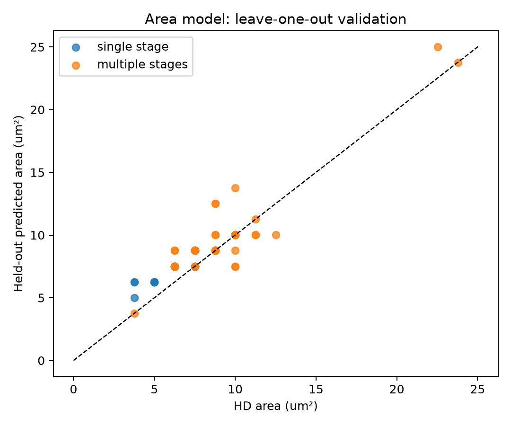
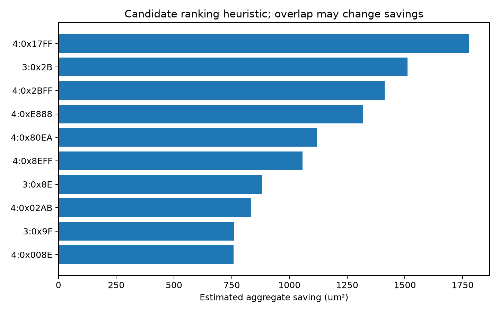
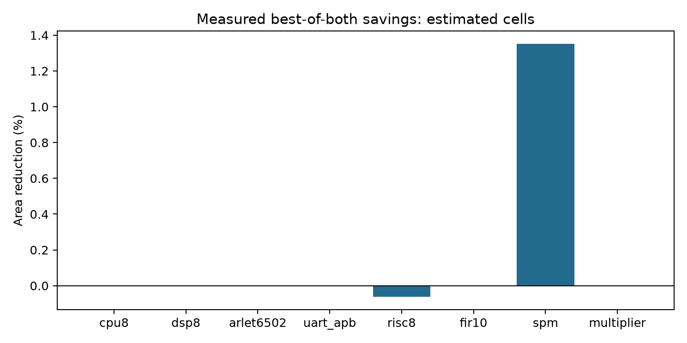

# GB4 — Option 2, Milestone 2

**Start here for the TA meeting.** Figures and tables are copies of the saved run; full evidence is in [results/m2](../results/m2/).

Experimental flow: **pass**. Full checkpoint ready: **True**.
Table 4: TA accepted recorded difference. The recorded counts remain visible.
See [the clarification and six examples](TABLE4_CLARIFICATION.md).

## What was verified

- M1 cuts independently checked: 423,730.
- Extended Liberty import: 199/199 cells.
- Area model: 61 HD x1 cells; leave-one-out mean absolute percentage error 14.61%.
- CEC: 32/32 pass.
- OpenSTA: 32/32 pass.
- Tutorial simulations: 10/10 pass.
- Tests: 101 passed in 47.51s. See [saved test log](validation/tests.log).

## Measured best-of-both area

| Design | Baseline (µm²) | Extended (µm²) | Area reduction |
|---|---:|---:|---:|
| cpu8 | 4165.2448 | 4165.2448 | 0.0000% |
| dsp8 | 5811.8240 | 5811.8240 | 0.0000% |
| arlet6502 | 9325.1936 | 9325.1936 | 0.0000% |
| uart_apb | 12773.5008 | 12773.5008 | 0.0000% |
| risc8 | 28094.4448 | 28111.9616 | -0.0623% |
| fir10 | 25463.1712 | 25463.1712 | 0.0000% |
| spm | 2869.0016 | 2830.2144 | 1.3519% |
| multiplier | 1736.6656 | 1736.6656 | 0.0000% |
| TOTAL | 85633.3792 | 85650.8960 | -0.0205% |

TOTAL covers the six required benchmarks. Tutorial rows are separate. A negative reduction means area increased.
M1 reproduces the Yosys 0.33 reference table; M2 uses the newer recorded toolchain with identical A/B commands on each side.
These areas use estimated cells. New-cell timing/capacitance values are placeholders; OpenSTA results are pre-layout comparisons.

## Figures

### 1. Area-model validation

Held-out predictions against the HD cell areas; the dashed line represents exact predictions.

### 2. Candidate ranking

Heuristic predicted savings used for ranking. Overlapping cuts and actual remapping can change the outcome.

### 3. Measured area reduction

Measured from the baseline and extended mappings, taking the smaller A/B area on each side.

## Tables

- [01_m1_reference_table.csv](tables/01_m1_reference_table.csv)
- [02_ranked_candidates.csv](tables/02_ranked_candidates.csv)
- [03_area_model_fit.csv](tables/03_area_model_fit.csv)
- [04_table5_estimated.csv](tables/04_table5_estimated.csv)
- [05_best_of_both.csv](tables/05_best_of_both.csv)
- [06_tutorial_aigs_and_cuts.csv](tables/06_tutorial_aigs_and_cuts.csv)

## Still open

Final milestone: real generator cells, final greedy selection, real-area reruns, cell-by-cell curve, 30% experiment, final reports and full unseen-design demo.

Copies are refreshed by `make ta` and after `make m2`. `evidence_sources.json` records their source hashes.
